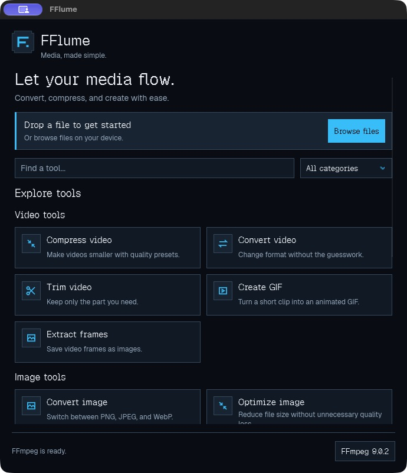
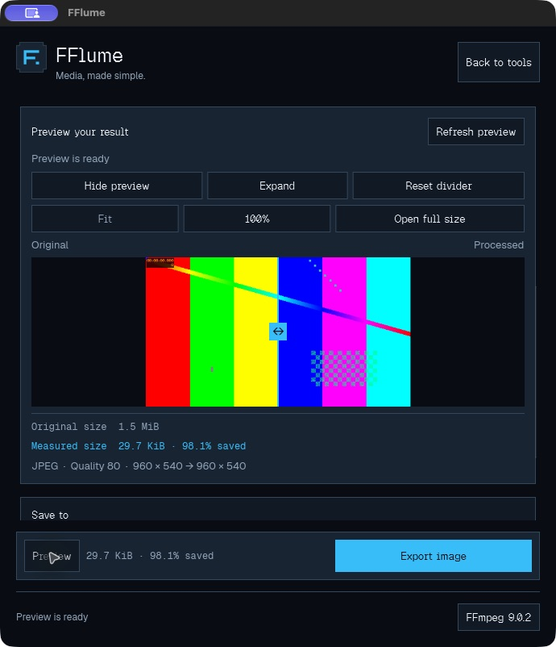

# FFlume

FFlume is a native desktop app for converting video, audio, images, and PDF pages. Browse the tools or open a file to see what you can do with it. Preview the result before you export.

Built with Rust and Slint. FFmpeg and ffprobe handle media processing, and Poppler handles PDFs.

| Tool dashboard | Before-and-after preview |
| --- | --- |
|  |  |

## What you can do

| Media | Tools |
| --- | --- |
| Video | Compress to H.264, convert between MP4 and MKV, trim, extract MP3 audio, create looping GIFs, or export individual frames and sequences. |
| Audio | Convert to MP3, WAV, FLAC, or Opus. Trim clips and normalize loudness. |
| Images | Convert to PNG, JPEG, or WebP. Resize by dimensions or scale, choose a quality preset, or target a file size for lossy JPEG and WebP. |
| PDF | Preview pages and export individual pages, ranges, or the entire document as PNG or JPEG. |

For images, drag the divider to compare the original with the encoded result. Use **Fit** to see the whole image or **100%** to inspect the center at native pixel scale. The preview reports the measured output size and shows when the result is larger. If the source and settings still match, FFlume can reuse the preview when you export.

Video compression compares frames at the same timestamp. GIFs play in the preview panel, and audio A/B samples open in the system player. Fast video trim copies streams, so cuts can land near keyframes. If an output name already exists, **Keep both** saves a numbered copy.

## Getting started on macOS

Apple Silicon is the verified platform. To build locally, install [Rust 1.92 or newer](https://rustup.rs/), the Xcode Command Line Tools, and [Homebrew](https://brew.sh/).

```sh
xcode-select --install  # Skip if the tools are already installed
brew install ffmpeg
cargo run --locked
```

For a release build:

```sh
cargo build --release --locked
./target/release/fflume
```

To make a local `FFlume.app` for testing, run `sh scripts/bundle-macos.sh` after the release build. Use `fflume --help` for command-line usage or `fflume --version` to check the installed version.

### Homebrew release status

The [source formula](homebrew-tap/Formula/fflume.rb) is prepared. Installation through a public tap is pending a tagged source archive and its checksum. Once the tap is published, replace `USERNAME` with the published tap owner. Homebrew builds FFlume from source using the Cargo lockfile and installs FFmpeg as a runtime dependency.

```sh
brew install USERNAME/tap/fflume
fflume

brew update
brew upgrade USERNAME/tap/fflume
brew uninstall USERNAME/tap/fflume
```

See the [Homebrew release checklist](docs/HOMEBREW_RELEASE.md) for publication and installation checks.

### Optional format support

- **WebP** requires an FFmpeg build with `libwebp`. If WebP is missing from the format list, click the FFmpeg version in the footer and use **Choose FFmpeg…** to select a compatible executable. Homebrew’s [ffmpeg-full](https://formulae.brew.sh/formula/ffmpeg-full) is one option.
- **PDF** requires Poppler. Install it with `brew install poppler` or use **Install Poppler** in FFlume. PDF export renders pages with a 2400-pixel long edge.

## Development

```sh
cargo fmt --check
cargo check --locked
cargo clippy --locked --all-targets -- -D warnings
cargo test --locked
```

To run the full integration suite, install FFmpeg with `libwebp`, ffprobe, and Poppler, then run `cargo test --locked -- --include-ignored`. Set `FFLUME_TEST_FFMPEG` or `FFLUME_TEST_FFPROBE` to select specific executables. If your FFmpeg lacks WebP support, add `--skip ffmpeg_webp_export` after `--`.

The default renderer is Winit with FemtoVG. To try the software renderer, run `cargo run --release --no-default-features --features renderer-software`. See the [QA report](docs/FINAL_QA_REPORT.md) for the tested workflows and platform coverage.

## License

FFlume is licensed under [GPL-3.0-only](LICENSE) and uses Slint under its GPL-3.0 option. The bundled Geist Pixel, Geist Sans, and Geist Mono fonts are from [Vercel’s Geist v1.9.2 release](https://github.com/vercel/geist-font/releases/tag/v1.9.2). See the [SIL Open Font License](assets/fonts/Geist-OFL.txt) and [original notice](assets/fonts/Geist-LICENSE.txt).
